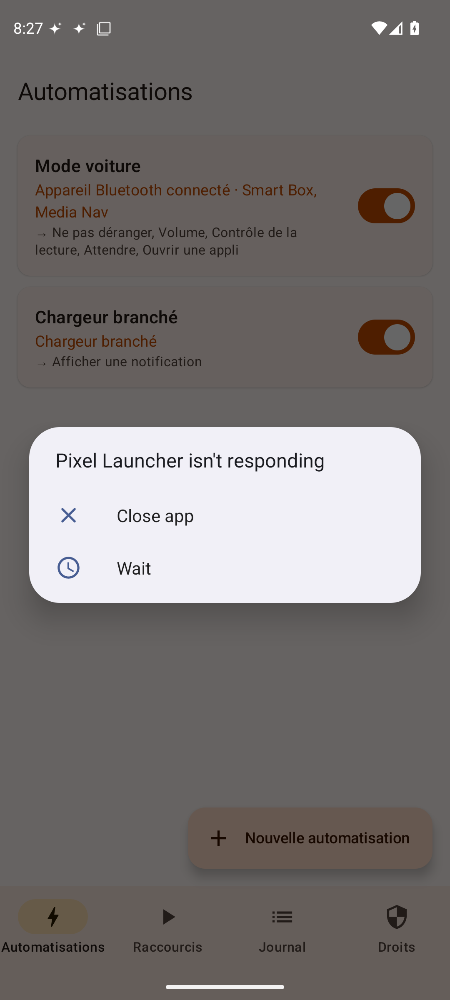
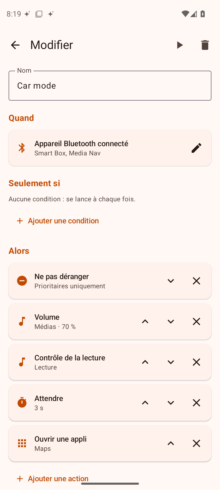
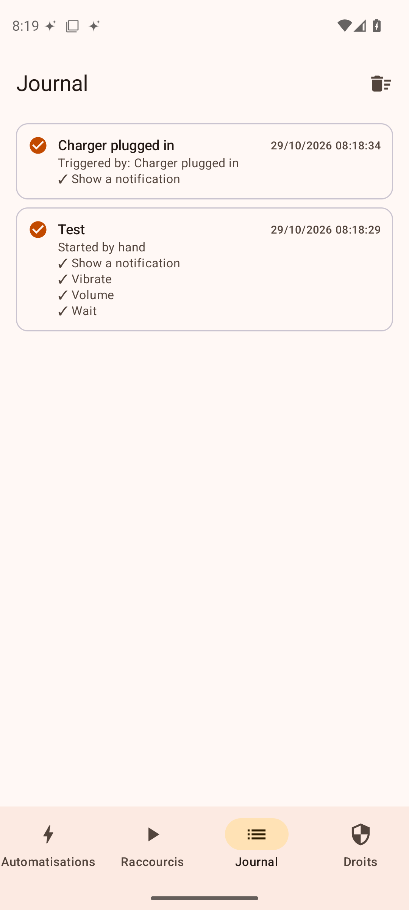
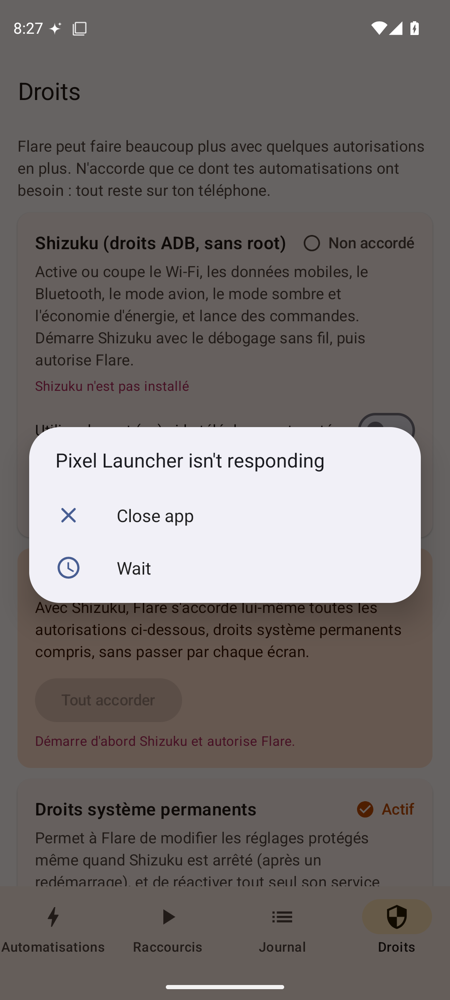

<div align="center">

[English](docs/readme/README_en.md) · [简体中文](docs/readme/README_zh.md) · [繁體中文](docs/readme/README_zh-TW.md) · [日本語](docs/readme/README_ja.md) · [한국어](docs/readme/README_ko.md) · [Türkçe](docs/readme/README_tr.md) · [Русский](docs/readme/README_ru.md) · [Tiếng Việt](docs/readme/README_vi.md) · [ไทย](docs/readme/README_th.md) · [Deutsch](docs/readme/README_de.md) · [Español](docs/readme/README_es.md) · **Français** · [Українська](docs/readme/README_uk.md) · [Polski](docs/readme/README_pl.md) · [Português (Brasil)](docs/readme/README_pt-BR.md) · [العربية](docs/readme/README_ar.md) · [فارسی](docs/readme/README_fa.md) · [Bahasa Indonesia](docs/readme/README_id.md) · [Italiano](docs/readme/README_it.md)
· [Ελληνικά](docs/readme/README_el.md) · [മലയാളം](docs/readme/README_ml.md) · [Roman Urdu](docs/readme/README_ur-Latn.md) · [Română](docs/readme/README_ro.md)

</div>

<p align="center"></p>

# Flare

Automatisations pour **Android**, dans l'esprit de l'appli Raccourcis d'Apple mais en plus poussé que « Modes et
routines » : **un déclencheur** (appareil Bluetooth connecté, Wi-Fi, chargeur, heure, appli ouverte, téléphone
déplié…), **des conditions** facultatives, puis **une suite d'actions** (réglages, applis, musique, commandes…), et
des actions « quand ça s'arrête » qui défont tout au bon moment.

Exemple livré avec l'appli : quand le téléphone se connecte en Bluetooth à la voiture, Flare active Ne pas
déranger, règle le volume, lance la musique dans [Opus](https://github.com/apkangelo/opus) et ouvre Maps ; à la
déconnexion, il met la musique en pause et coupe Ne pas déranger.

Pensé pour le Galaxy Z Fold sous One UI : déclencheurs « téléphone plié / déplié », et pas besoin de root (Samsung ne
permet plus de déverrouiller le bootloader) grâce à Shizuku.

## Télécharger

**[Flare.apk](https://github.com/apkangelo/Flare/releases/latest/download/Flare.apk)** (Android 8 ou plus récent).
Ouvre le fichier, autorise l'installation depuis cette source, puis *Installer*. Les mises à jour s'installent
par-dessus sans perdre tes automatisations. Toutes les versions sont dans l'onglet
[*Releases*](https://github.com/apkangelo/Flare/releases), compilées par GitHub Actions à chaque modification.

## Captures

| Automatisations | Éditeur | Journal | Droits |
|---|---|---|---|
|  |  |  |  |

## Ce que fait Flare

**Déclencheurs (27)** : appareil Bluetooth connecté / déconnecté (une partie du nom suffit : « Media Nav » reconnaît
« MEDIA-NAV »), Wi-Fi connecté / déconnecté, mode avion, chargeur branché / débranché, niveau de batterie, démarrage du
téléphone, écran allumé / éteint, déverrouillage, **téléphone plié / déplié**, écouteurs branchés / débranchés, heure
précise et jours, toutes les X minutes, appli ouverte / fermée, notification reçue (appli, texte), appel entrant /
commencé / terminé, SMS reçu, arrivée dans un lieu / départ.

**Conditions (11)** : plage horaire, jours de la semaine, batterie, en charge, appareil Bluetooth connecté, réseau
Wi-Fi, plié / déplié, écouteurs, écran allumé, mode de sonnerie, appli à l'écran.

**Actions (40)**
- *Connexions* : Wi-Fi, données mobiles, Bluetooth, mode avion, NFC, position (activer, désactiver, inverser).
- *Écran* : luminosité, mise en veille, rotation, mode sombre, rester allumé en charge, économie d'énergie, lampe
  torche, verrouiller, allumer l'écran, capture d'écran.
- *Son et médias* : mode de sonnerie, Ne pas déranger, volume de chaque flux, lecture / pause / suivant, lancer la
  musique dans une appli précise, lire un texte à voix haute, vibrer.
- *Applis* : ouvrir une appli, un lien ou un lien profond (`opus://flow`, `tel:`, `geo:`…), itinéraire Maps, forcer
  l'arrêt, ouvrir une page des réglages, envoyer un intent.
- *Pilotage de l'écran* : boutons système (retour, accueil, récents, volet, réglages rapides, menu marche/arrêt, écran
  partagé), toucher un texte à l'écran, effacer les notifications.
- *Appels et SMS* : envoyer un SMS, appeler.
- *Système* : notification, **commande shell**, **n'importe quel paramètre système** (`system`, `secure`, `global`),
  ce qui couvre aussi les réglages propres à One UI.
- *Déroulement* : attendre, lancer un raccourci, activer / désactiver une automatisation.

**Raccourcis** : des listes d'actions sans déclencheur, lancées d'un geste depuis l'appli, depuis l'**écran
d'accueil** ou depuis l'une des **3 tuiles des réglages rapides**.

**Journal** de tout ce qui s'est lancé (avec le résultat de chaque action), **export / import** en JSON, interface
en **23 langues**.

## Les droits, pas à pas

Flare n'a besoin du root pour rien. Chaque action affiche l'accès qui lui manque, et l'onglet **Droits** regroupe tout.

1. **Options de développement** : Paramètres › À propos du téléphone › Informations sur le logiciel, touche 7 fois
   *Numéro de version*.
2. **Shizuku** : installe [Shizuku](https://shizuku.rikka.app/download/), active *Débogage sans fil* dans les options
   de développement (en Wi-Fi), puis dans Shizuku : *Démarrer via le débogage sans fil* › *Associer*, et saisis le code
   d'association dans la notification.
3. Dans Flare › **Droits** : *Shizuku › Accorder*, puis **Tout accorder**. Flare s'accorde lui-même les droits système
   permanents, l'accessibilité, l'accès aux notifications, Ne pas déranger, l'affichage par-dessus les applis,
   l'absence de restriction de batterie et les permissions Android.
4. Sur Samsung : Paramètres › Applis › Flare › Batterie › **Non restreinte**.

Après un redémarrage, Shizuku doit être relancé (étape 2, sans refaire l'association) pour les actions Wi-Fi,
données mobiles, Bluetooth, mode avion, mode sombre et commandes. Le reste continue de fonctionner grâce aux droits
système permanents.

Sans Shizuku, depuis un ordinateur :

```sh
adb shell pm grant fr.apkfold.flare android.permission.WRITE_SECURE_SETTINGS
```

Si l'accessibilité ou l'accès aux notifications sont grisés (appli installée hors Play Store) : Infos sur l'appli ›
⋮ › *Autoriser les paramètres restreints*.

## Avec Opus

L'exemple « Mode voiture » ouvre `opus://flow`, qui lance le Flow d'[Opus](https://github.com/apkangelo/opus).
L'action *Lancer la musique dans une appli* fonctionne aussi avec n'importe quel lecteur (Spotify, YouTube Music,
Deezer…) : elle passe par la session média de l'appli, ou lui envoie la touche « lecture ».

## Compiler soi-même

Il faut le JDK 21 et le SDK Android (ou Android Studio).

```sh
python3 scripts/i18n.py        # régénère les textes Android depuis i18n/*.json
cd android
./gradlew assembleRelease      # → android/app/build/outputs/apk/release/app-release.apk
```

À chaque modification, GitHub Actions vérifie les 23 traductions, compile et publie l'APK. Un second workflow lance
l'appli dans un émulateur Android 15, simule un branchement du chargeur pour vérifier que le moteur réagit, et prend
les captures ci-dessus.

## Signature de l'APK

Toutes les versions sont signées avec **la même clé** (`signing/flare.jks`) pour que les mises à jour s'installent
par-dessus. Cette clé est publique dans le dépôt : n'installe Flare que depuis ce dépôt. Pour utiliser une clé privée,
ajoute dans *Settings › Secrets › Actions* les secrets `FLARE_KEYSTORE_B64` (le fichier .jks en base64),
`FLARE_KEYSTORE_PASSWORD`, `FLARE_KEY_ALIAS` et `FLARE_KEY_PASSWORD`.

## Bon à savoir

- Automatisations, journal et réglages restent **sur le téléphone**. Flare n'a pas accès à Internet.
- Les commandes shell tournent avec les droits ADB de Shizuku : n'y colle que des commandes que tu comprends.
- Le nom du réseau Wi-Fi n'est lisible qu'avec la permission de position (règle d'Android).

## Organisation du dépôt

| Dossier | Contenu |
|---|---|
| `android/` | L'appli (Kotlin, Jetpack Compose) : moteur dans `core/`, services dans `service/`, écrans dans `ui/` |
| `i18n/` | Les textes de l'interface dans les 23 langues |
| `scripts/` | Génération des textes, test sur émulateur, aide à la compilation |
| `docs/` | Captures d'écran et README traduits |
| `signing/` | Clé de signature de l'APK |

## Les autres applis apk-fold

- [Haiku](https://github.com/apkangelo/haiku) : gestionnaire de mots de passe hors ligne
- [Opus](https://github.com/apkangelo/opus) : lecteur de musique pour Navidrome
- [Sonnet](https://github.com/apkangelo/sonnet) : client Jellyfin
- [Mythos](https://github.com/apkangelo/mythos) : suite bureautique synchronisée sans serveur
- [Fable](https://github.com/apkangelo/fable) : suivi des heures de travail
- [Cyber](https://github.com/apkangelo/Cyber) : terminal SSH et shell local
