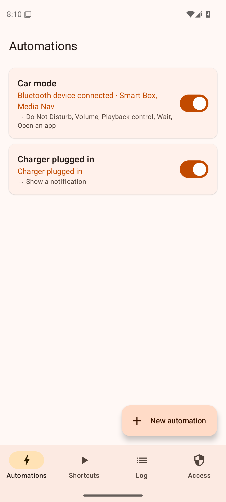
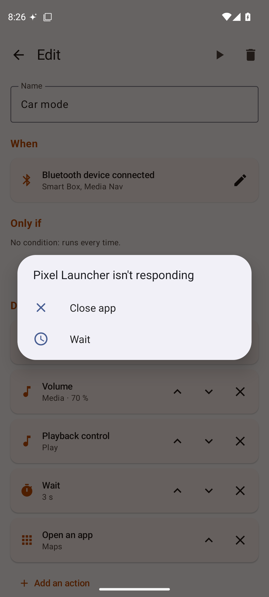
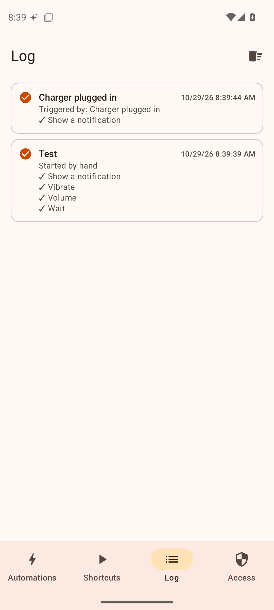
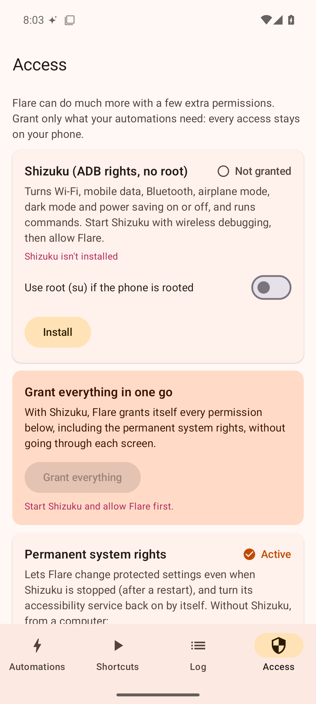

<div align="center">

[English](README_en.md) · [简体中文](README_zh.md) · [繁體中文](README_zh-TW.md) · [日本語](README_ja.md) · [한국어](README_ko.md) · [Türkçe](README_tr.md) · **Русский** · [Tiếng Việt](README_vi.md) · [ไทย](README_th.md) · [Deutsch](README_de.md) · [Español](README_es.md) · [Français](../../README.md) · [Українська](README_uk.md) · [Polski](README_pl.md) · [Português (Brasil)](README_pt-BR.md) · [العربية](README_ar.md) · [فارسی](README_fa.md) · [Bahasa Indonesia](README_id.md) · [Italiano](README_it.md)
· [Ελληνικά](README_el.md) · [മലയാളം](README_ml.md) · [Roman Urdu](README_ur-Latn.md) · [Română](README_ro.md)

</div>

<p align="center"></p>

# Flare

Автоматизации для **Android** в духе приложения «Команды» от Apple, но мощнее, чем «Режимы и процедуры» Samsung:
**триггер** (подключено Bluetooth-устройство, Wi-Fi, зарядка, время, открыто приложение, телефон раскрыт…),
необязательные **условия**, затем **цепочка действий** (настройки, приложения, музыка, команды…), а также действия
«когда это закончится», которые в нужный момент всё возвращают обратно.

Пример в комплекте: когда телефон подключается к машине по Bluetooth, Flare включает «Не беспокоить», выставляет
громкость, запускает музыку в [Opus](https://github.com/apkangelo/opus) и открывает Карты; при отключении ставит музыку
на паузу и выключает «Не беспокоить».

Сделано для Galaxy Z Fold на One UI: триггеры «телефон сложен / раскрыт», и никакого root (Samsung больше не даёт
разблокировать загрузчик) — благодаря Shizuku.

## Скачать

**[Flare.apk](https://github.com/apkangelo/Flare/releases/latest/download/Flare.apk)** (Android 8 и новее). Откройте
файл, разрешите установку из этого источника и нажмите *Установить*. Обновления ставятся поверх без потери
автоматизаций. Все версии — во вкладке [*Releases*](https://github.com/apkangelo/Flare/releases), их собирает GitHub
Actions при каждом изменении.

## Скриншоты

| Автоматизации | Редактор | Журнал | Доступ |
|---|---|---|---|
|  |  |  |  |

## Что умеет Flare

**Триггеры (27)**: Bluetooth-устройство подключено / отключено (достаточно части названия: «Media Nav» найдёт
«MEDIA-NAV»), Wi-Fi подключён / отключён, режим полёта, зарядка подключена / отключена, уровень заряда, включение
телефона, экран включён / выключен, разблокировка, **телефон сложен / раскрыт**, наушники подключены / отключены,
заданное время и дни, каждые X минут, приложение открыто / закрыто, получено уведомление (приложение, текст), звонок
входящий / начат / завершён, получено SMS, прибытие в место / уход.

**Условия (11)**: промежуток времени, дни недели, заряд, зарядка, подключено Bluetooth-устройство, сеть Wi-Fi, сложен /
раскрыт, наушники, экран включён, режим звонка, приложение на экране.

**Действия (40)**
- *Подключения*: Wi-Fi, мобильные данные, Bluetooth, режим полёта, NFC, геолокация (вкл., выкл., переключить).
- *Экран*: яркость, тайм-аут экрана, поворот, тёмная тема, не гасить при зарядке, энергосбережение, фонарик,
  блокировка, включить экран, скриншот.
- *Звук и медиа*: режим звонка, «Не беспокоить», громкость каждого потока, воспроизведение / пауза / следующий трек,
  включить музыку в нужном приложении, прочитать текст вслух, вибрация.
- *Приложения*: открыть приложение, ссылку или deep link (`opus://flow`, `tel:`, `geo:`…), навигация в Картах,
  принудительная остановка, открыть страницу настроек, отправить intent.
- *Управление экраном*: системные кнопки (назад, домой, недавние, панель уведомлений, быстрые настройки, меню питания,
  разделённый экран), коснуться текста на экране, очистить уведомления.
- *Звонки и SMS*: отправить SMS, позвонить.
- *Система*: уведомление, **команда shell**, **любая системная настройка** (`system`, `secure`, `global`) — это
  покрывает и собственные настройки One UI.
- *Ход выполнения*: подождать, запустить ярлык, включить / выключить автоматизацию.

**Ярлыки**: списки действий без триггера, запускаются одним касанием из приложения, с **главного экрана** или с одной
из **3 плиток быстрых настроек**.

**Журнал** всех запусков (с результатом каждого действия), **экспорт / импорт** в JSON, интерфейс на **23 языках**.

## Доступ по шагам

Flare никогда не нужен root. Каждое действие показывает, какого доступа ему не хватает, а вкладка **Доступ** собирает
всё в одном месте.

1. **Параметры разработчика**: Настройки › Сведения о телефоне › Сведения о ПО, 7 раз нажмите *Номер сборки*.
2. **Shizuku**: установите [Shizuku](https://shizuku.rikka.app/download/), включите *Отладку по Wi-Fi* в параметрах
   разработчика (при подключении к Wi-Fi), затем в Shizuku: *Запуск через беспроводную отладку* › *Сопряжение*
   и введите код сопряжения в уведомлении.
3. В Flare › **Доступ**: *Shizuku › Выдать*, затем **Выдать всё**. Flare сам выдаёт себе постоянные системные права,
   спецвозможности, доступ к уведомлениям, «Не беспокоить», показ поверх других приложений, отсутствие ограничений
   батареи и разрешения Android.
4. На Samsung: Настройки › Приложения › Flare › Батарея › **Без ограничений**.

После перезагрузки Shizuku нужно запустить снова (шаг 2, без повторного сопряжения) для действий Wi-Fi, мобильные
данные, Bluetooth, режим полёта, тёмная тема и команды. Остальное продолжает работать благодаря постоянным системным
правам.

Без Shizuku, с компьютера:

```sh
adb shell pm grant fr.apkfold.flare android.permission.WRITE_SECURE_SETTINGS
```

Если спецвозможности или доступ к уведомлениям неактивны (приложение установлено не из Play Маркета): О приложении ›
⋮ › *Разрешить ограниченные настройки*.

## С Opus

Пример «Режим автомобиля» открывает `opus://flow`, что запускает Flow в [Opus](https://github.com/apkangelo/opus).
Действие *Включить музыку в приложении* работает и с любым другим плеером (Spotify, YouTube Music, Deezer…): через
медиасессию приложения или отправкой клавиши «воспроизведение».

## Собрать самому

Нужны JDK 21 и Android SDK (или Android Studio).

```sh
python3 scripts/i18n.py        # генерирует строки Android из i18n/*.json
cd android
./gradlew assembleRelease      # → android/app/build/outputs/apk/release/app-release.apk
```

При каждом изменении GitHub Actions проверяет 23 перевода, собирает и публикует APK. Второй workflow запускает
приложение в эмуляторе Android 15, имитирует подключение зарядки, чтобы проверить реакцию движка, и делает скриншоты
выше.

## Подпись APK

Все версии подписаны **одним ключом** (`signing/flare.jks`), чтобы обновления ставились поверх. Ключ открыт
в репозитории: устанавливайте Flare только отсюда. Для своего закрытого ключа добавьте в *Settings › Secrets ›
Actions* секреты `FLARE_KEYSTORE_B64` (файл .jks в base64), `FLARE_KEYSTORE_PASSWORD`, `FLARE_KEY_ALIAS`
и `FLARE_KEY_PASSWORD`.

## Полезно знать

- Автоматизации, журнал и настройки остаются **на телефоне**. У Flare нет доступа к интернету.
- Команды shell выполняются с правами ADB от Shizuku: вставляйте только понятные вам команды.
- Название сети Wi-Fi можно прочитать только с разрешением на геолокацию (правило Android).

## Устройство репозитория

| Папка | Содержимое |
|---|---|
| `android/` | Приложение (Kotlin, Jetpack Compose): движок в `core/`, службы в `service/`, экраны в `ui/` |
| `i18n/` | Тексты интерфейса на 23 языках |
| `scripts/` | Генерация строк, тест на эмуляторе, помощь при сборке |
| `docs/` | Скриншоты и переведённые README |
| `signing/` | Ключ подписи APK |

## Другие приложения apk-fold

- [Haiku](https://github.com/apkangelo/haiku): офлайн-менеджер паролей
- [Opus](https://github.com/apkangelo/opus): музыкальный плеер для Navidrome
- [Sonnet](https://github.com/apkangelo/sonnet): клиент Jellyfin
- [Mythos](https://github.com/apkangelo/mythos): офисный пакет с синхронизацией без сервера
- [Fable](https://github.com/apkangelo/fable): учёт рабочего времени
- [Cyber](https://github.com/apkangelo/Cyber): SSH-терминал и локальная оболочка
